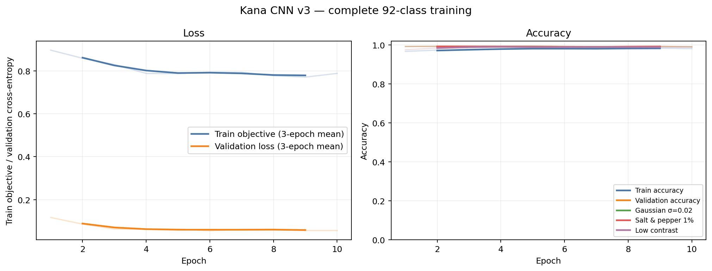
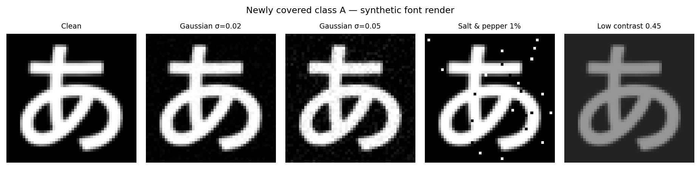

# 假名识别器 v3 · Kana Recognizer v3

**中文**：92 类日语基本假名单字识别器，基于 PyTorch，输入必须是**单个已分割好的字符**。本目录保留 v2 基线，并新增针对噪声和弱对比度微调的 v3 权重与训练报告。

**English**: A 92-class single-character Japanese kana recognizer built with PyTorch. Input must be **one isolated character**. This directory keeps the v2 baseline and adds v3 noise and low-contrast fine-tuning, weights and reports.

> **中文 · 范围声明**：v2 基线的真实手写平假名通过了跨来源外部基准验证；v3 已覆盖 92 类，但本轮只用字体渲染图训练与评估，尚未重新跑手写基准；新增的 12 类由本机日文字体生成。**片假名仍缺少真实手写验收**。本项目不是通用日语 OCR，不覆盖浊音、半浊音、小假名、长音符与多字符文本。
>
> **English · Scope**: The v2 baseline passed a cross-source handwritten hiragana benchmark. V3 covers all 92 classes but was trained and evaluated only on font renders; its handwritten performance has not been rechecked. The 12 newly added classes use local system-font renders. **Katakana still lacks real-handwriting validation**. This is not general-purpose Japanese OCR — voiced marks, small kana, long-vowel marks and multi-character text are out of scope.

---

## 目录 · Contents

| | |
|---|---|
| [1. v2 更新要点](#1-v2-更新要点--whats-new-in-v2) | What's new in v2 |
| [2. 实测成绩](#2-实测成绩--measured-results) | Measured results |
| [3. 已知限制](#3-已知限制--known-limitations) | Known limitations |
| [4. 安装](#4-安装--installation) | Installation |
| [5. 快速开始](#5-快速开始--quick-start) | Quick start |
| [6. 仓库结构](#6-仓库结构--repository-layout) | Repository layout |
| [7. 数据与许可](#7-数据与许可--data-and-licensing) | Data and licensing |
| [8. 复现实验](#8-复现实验--reproducibility) | Reproducibility |
| [9. 常见问题](#9-常见问题--faq) | FAQ |
| [10. 致谢与来源](#10-致谢与来源--credits) | Credits |
| [11. v3 抗干扰微调](#11-v3-抗干扰微调--noise-robust-fine-tuning) | v3 noise-robust fine-tuning |

---

## 1. v2 更新要点 · What's new in v2

**中文**：v2 是一次工程化重写。v1 是两个独立脚本（训练仪表板 + 选图窗口），v2 改为可复用的 Python 包与命令行工具，重点补上了数据溯源、划分隔离、模型导出与置信度标定。识别网络本身仍是 1.49M 参数的 6 层 CNN。

**English**: v2 is an engineering rewrite. v1 was two standalone scripts (a training dashboard and a file-picker GUI); v2 becomes a reusable Python package with a CLI, adding data provenance, split isolation, model export and confidence calibration. The network itself is unchanged in spirit — a 1.49M-parameter 6-layer CNN.

| 项目 · Item | v1 | v2 |
|---|---|---|
| 代码组织 · Layout | 2 个独立脚本 | 可复用包 `kana_recognizer`，`python -m` 入口 |
| 接口 · Interface | 训练仪表板 / 选图窗口 | `prepare` `train` `evaluate` `predict` `export` 五个子命令 |
| 数据溯源 · Provenance | 无 | 源数据 SHA-256、数据指纹、逐图 manifest、像素哈希去重 |
| 划分隔离 · Split isolation | 按类别随机 | 字体分组隔离 + 跨划分像素哈希去重 |
| 权重发布 · Weights | 源码不含权重 | **含 `models/best.pt`，clone 后可直接推理** |
| 模型导出 · Export | 无 | TorchScript 与 `torch.export` 的 `.pt2` |
| 置信度 · Confidence | 无 | 验证集温度标定 + `needs_review` 阈值提示 |
| 断点续训 · Resume | 支持（需输出目录与总轮数一致） | 支持，含优化器/调度器/RNG 状态与数据指纹校验 |
| 运行依赖 · Runtime deps | 需要 Matplotlib | 不需要 Matplotlib、GUI 或 TensorFlow |

---

## 2. 实测成绩 · Measured results

**中文**：最佳权重为第 28 轮，仅按验证集 macro-recall 选择。验证集拟合温度 0.6，用于调整 softmax 分数，不改变 Top-1 结果。所有预测都在 92 个输出中竞争，未限制为平假名。训练使用 RTX 4080 Laptop GPU、40 轮。

**English**: The best checkpoint is epoch 28, selected on validation macro-recall only. Temperature 0.6 is fitted on validation to adjust softmax scores and does not change Top-1 predictions. All predictions compete across all 92 outputs — no restriction to hiragana. Trained for 40 epochs on an RTX 4080 Laptop GPU.

| 数据集 · Dataset | 样本数 · Samples | 准确率 · Accuracy |
|---|---:|---:|
| Hiraganani 官方另附测试图片 · Hiraganani provided test | 400 | 99.75% |
| 原字体库：按字体隔离的测试集 · Font library, font-isolated test | 640 | 95.16% |
| 系统字体：隔离的测试集 · System fonts, isolated test | 184 | 99.46% |
| 本地混合测试集 · Local mixed test | 1,224 | 97.30% |
| **Inoue 独立手写：46 类平假名 · Inoue independent handwriting, 46 hiragana** | **920** | **95.98%** |
| 与 v1 相同的 36 类外部样本 · Same 36 external classes as v1 | 720 | **95.97%**（v1：46.25%） |

**中文**：外部原始 1000 张中有 80 张属于「ば だ じ ぴ」等不在基础 92 类内的字符，全部计错时为 88.30%。训练使用了新数据、新模型与新预处理，上述提升不能归因于某一项单独改动。Hiraganani 未公开逐图书写者标识，因此其验证与测试不能称为书写者隔离。

**English**: Of the 1,000 original external images, 80 are characters such as ば だ じ ぴ that fall outside the basic 92 classes; counting all of them as errors gives 88.30%. Training used new data, a new model and new preprocessing, so the improvement cannot be attributed to any single change. Hiraganani does not publish per-image writer IDs, so its validation and test splits cannot be claimed as writer-disjoint.

### 模型规格 · Model spec

| 项目 · Item | 值 · Value |
|---|---|
| 参数量 · Parameters | 1,490,428（约 5.96 MB，fp32） |
| 输入 · Input | 48×48 单通道灰度，白字黑底 |
| 输出 · Output | 92 类 logits（除以温度后 softmax） |
| 推理速度 · Inference | CPU 约 0.66 ms/张（约 1,500 张/秒，批量） |
| Top-3 准确率 · Top-3 | 外部集 99.89%，本地测试集 99.59% |

---

## 3. 已知限制 · Known limitations

**中文**：请务必阅读。以下是实测发现的问题，不是免责套话。

**English**: Please read this section. These are measured findings, not boilerplate disclaimers.

### 3.1 片假名没有真实手写训练数据

**中文**：训练集里 46 个片假名类共 1,939 张，**全部来自字体渲染，一张真实手写都没有**；而平假名有 9,673 张真实手写。外部基准只覆盖 46 个平假名类，因此**片假名的真实手写泛化能力完全没有被验证过**。「支持 92 类」在类别表上成立，在能力上不成立。ア イ ウ エ オ ン 六个类各只有 8 张字体样本。

**English**: The 46 katakana classes have 1,939 training images in total, **all font renders, with zero real handwriting**; hiragana has 9,673 real handwritten samples. The external benchmark covers only the 46 hiragana classes, so **katakana generalisation to real handwriting is entirely unverified**. "92 classes" holds for the label set, not for demonstrated capability. ア イ ウ エ オ ン have only 8 font samples each.

### 3.2 对噪声极其敏感

**中文**：在本地测试集上施加轻微高斯噪声（σ=0.02，约 5/255 灰阶，肉眼几乎不可见），准确率从 97.30% **掉到 72.06%**；σ=0.05 时降到 32.84%，σ=0.10 时降到 6.45%。椒盐噪声 1% 时为 81.29%。原因是训练增强只有仿射、形态学与亮度扰动，不含任何噪声或压缩类增强。几何扰动方面表现正常：旋转 ±8°、平移 3px、笔画变细、模糊、降采样都基本无损。

**English**: Adding mild Gaussian noise (σ=0.02, about 5/255 grey levels, nearly invisible) to the local test set drops accuracy from 97.30% **to 72.06%**; σ=0.05 gives 32.84% and σ=0.10 gives 6.45%. Salt-and-pepper noise at 1% gives 81.29%. The cause is that training augmentation covers only affine, morphological and brightness transforms — no noise or compression augmentations. Geometric perturbations are handled fine: rotation ±8°, 3px shift, thinner strokes, blur and downsampling are all nearly lossless.

> **中文 · 部署提示**：扫描件、拍照、铅笔书写、JPEG 压缩伪影都可能触发这一失效模式。用于真实场景前请先做降噪预处理。
>
> **English · Deployment note**: Scans, camera captures, pencil writing and JPEG artefacts can all trigger this failure mode. Apply denoising before using the model in production.

### 3.3 「へ / ヘ」在孤立呈现时本质不可分

**中文**：外部集上「へ」的召回率只有 **15%**（20 张错 17 张，全部判成片假名「ヘ」）。这两个字符单独出现时图像上几乎相同，属于固有歧义，增加训练量无法解决。建议在上层把该对作为并列候选返回，而不是强行二选一。

**English**: Recall for へ on the external set is only **15%** (17 of 20 misclassified as katakana ヘ). In isolation the two glyphs are nearly identical, so this is an intrinsic ambiguity that more training cannot fix. Consider returning this pair as tied candidates at the application layer instead of forcing a single choice.

### 3.4 错误集中在跨文字系统误判

**中文**：外部集 920 张共 37 个错误，其中 **31 个是平假名被判成片假名**（へ→ヘ 17、つ→フ 8、り→リ 5、や→カ 1）。若把输出限制在平假名，准确率为 **99.35%**；仅排除「へ」这一类，为 **97.78%**。

**English**: Of the 37 errors on the 920-image external set, **31 are hiragana misclassified as katakana** (へ→ヘ 17, つ→フ 8, り→リ 5, や→カ 1). Constraining output to hiragana gives **99.35%**; excluding just the へ class gives **97.78%**.

### 3.5 置信度过度自信

**中文**：温度 0.6 下，外部集平均置信度 0.983 而实际准确率 0.960。37 个错误中有 22 个得分 ≥ 0.8，因此默认阈值下的 `needs_review` **只能抓住 15/37（40.5%）**，同时误报 16 个正确预测。它只是一个分数提示，**不构成域外图片的检测保证**。

**English**: At temperature 0.6 the mean confidence on the external set is 0.983 while actual accuracy is 0.960. Of the 37 errors, 22 score ≥ 0.8, so `needs_review` at the default threshold **catches only 15/37 (40.5%)** while flagging 16 correct predictions. It is a score heuristic only and **not an out-of-distribution guarantee**.

### 3.6 单次重训约有 ±1 个百分点的抖动

**中文**：用**完全相同的数据与随机种子**重训一次，外部集成绩为 95.00%，低于本发布模型的 95.98%。GPU 非确定性足以造成这个量级的差异。因此不要把单次运行的零点几个百分点当成真实改进；对比改动请至少跑 3 个种子取均值。此外，验证集与训练集来自同一批数据且书写者未知，验证指标偏乐观，用它挑出的"最佳轮次"不保证泛化最好。

**English**: Retraining with **identical data and seed** produced 95.00% on the external set versus 95.98% for the released model. GPU nondeterminism alone accounts for this magnitude of difference. Do not treat sub-point differences from a single run as real improvements — use at least 3 seeds and average when comparing changes. Also, the validation set shares provenance (and likely writers) with training data, so validation metrics are optimistic and the "best epoch" chosen on it does not guarantee the best generalisation.

---

## 4. 安装 · Installation

**中文**：需要 Python 3.10 或更高版本。实际验证环境为 Windows 11、Python 3.13、PyTorch 2.14.1+cu126、RTX 4080 Laptop GPU；CUDA 训练与 CPU 推理均已验证。MPS 有自动选择逻辑，但未经 Apple 实机验证。

**English**: Requires Python 3.10 or newer. Verified on Windows 11, Python 3.13, PyTorch 2.14.1+cu126, RTX 4080 Laptop GPU; CUDA training and CPU inference are both tested. MPS auto-selection exists but is not verified on Apple hardware.

```bash
python -m venv .venv
```

```powershell
# Windows PowerShell
.\.venv\Scripts\Activate.ps1
```

```bash
# macOS / Linux
source .venv/bin/activate
```

```bash
pip install -r requirements.txt
```

**中文**：`requirements.txt` 只有 torch、numpy、Pillow。运行时不依赖 Matplotlib、图形界面或 TensorFlow。

**English**: `requirements.txt` contains only torch, numpy and Pillow. The runtime does not depend on Matplotlib, a GUI, or TensorFlow.

---

## 5. 快速开始 · Quick start

**中文**：以下命令都在**仓库根目录**执行。`python -m kana_recognizer` 依赖根目录在 `sys.path` 上，在其他目录运行会报找不到模块。

**English**: Run all commands from the **repository root**. `python -m kana_recognizer` requires the root to be on `sys.path`; running it elsewhere raises a module-not-found error.

### 5.1 查看帮助 · Help

```bash
python -m kana_recognizer --help
```

### 5.2 预测单张图片 · Predict one image

```bash
python -m kana_recognizer predict \
  --model kana_recognizer/models/best.pt \
  --image reports/example.png \
  --top-k 3
```

**中文**：输出 JSON，含 `prediction`、`needs_review`、`candidates`（字符、假名种类、分数）。

**English**: Prints JSON containing `prediction`, `needs_review` and `candidates` (character, script, score).

### 5.3 Python API

```python
from kana_recognizer import KanaRecognizer

recognizer = KanaRecognizer('kana_recognizer/models/best.pt', device='auto')
result = recognizer.predict('your_image.png', top_k=5, threshold=0.8)

print(result['prediction'])    # 预测字符 / predicted character
print(result['needs_review'])  # 是否需要人工复核 / whether to review
print(result['candidates'])    # 前 5 个候选 / top-5 candidates
```

**中文**：`device='auto'` 的选择顺序是 CUDA → MPS → CPU。预处理会自动校正 EXIF、合成透明通道、识别黑白极性、裁剪前景并按比例居中到 48×48；空白图会明确报错。

**English**: `device='auto'` resolves as CUDA → MPS → CPU. Preprocessing corrects EXIF, composites alpha onto white, detects polarity, crops the foreground and centre-resizes to 48×48 while preserving aspect ratio; blank images raise an explicit error.

### 5.4 训练 · Training

**中文**：仓库不含训练数据（见[第 7 节](#7-数据与许可--data-and-licensing)）。需先用 `prepare` 从原始数据生成 `data/prepared`，或自备同格式数据。

**English**: The repository does not ship training data (see [section 7](#7-数据与许可--data-and-licensing)). Run `prepare` on the raw sources to build `data/prepared`, or supply data in the same format.

```bash
# 1) 从原始数据准备（需要自行下载三个数据源）/ build the dataset
python -m kana_recognizer prepare \
  --hiragana-train hiraganani_train.zip \
  --hiragana-test  hiraganani_test.zip \
  --font-root      <7500-unique-kana-images 解压目录> \
  --external       hiragana_images.zip \
  --output         data/prepared

# 2) 训练 / train
python -m kana_recognizer train \
  --data   data/prepared \
  --output runs/v2 \
  --epochs 40 \
  --device auto

# 3) 中断后在同一输出目录、相同总轮数下恢复 / resume after interruption
python -m kana_recognizer train \
  --data   data/prepared \
  --output runs/v2 \
  --epochs 40 \
  --resume runs/v2/last.pt
```

**中文**：导入模块不会触发训练或设备初始化。训练使用类别均衡采样、标签平滑 0.04、AdamW + 余弦退火，按验证集 macro-recall 保存最佳权重，patience 12 触发早停。

**English**: Importing the module triggers no training and no device initialisation. Training uses class-balanced sampling, label smoothing 0.04, AdamW with cosine annealing, saves the best weights by validation macro-recall, and stops early after patience 12.

### 5.5 评估与导出 · Evaluate and export

```bash
python -m kana_recognizer evaluate \
  --model  kana_recognizer/models/best.pt \
  --data   data/prepared/external.npz \
  --output runs/external_metrics.json

python -m kana_recognizer export \
  --model  kana_recognizer/models/best.pt \
  --output runs/export
```

**中文**：调用导出的 TorchScript / `.pt2` 文件时，仍需执行同一套预处理，并把 logits 除以 `metadata.json` 里的 `temperature` 再做 softmax。

**English**: When using the exported TorchScript / `.pt2` files you must still apply the same preprocessing and divide the logits by `temperature` from `metadata.json` before softmax.

### 5.6 附带的演示脚本 · Bundled demo scripts

**中文**：`kana_demo/` 下有两个可直接在 IDE 里右键运行的脚本，比命令行更适合下断点调试。

**English**: `kana_demo/` contains two scripts you can right-click and run in an IDE — more convenient than the CLI when you want breakpoints.

- `kana_demo/predict_demo.py`：加载模型并对样本图片批量预测 / loads the model and predicts on sample images
- `kana_demo/train_demo.py`：以 Python API 训练，检测到已有 `last.pt` 时自动续训 / trains via the Python API and auto-resumes if `last.pt` exists

---

## 6. 仓库结构 · Repository layout

```text
.
├── README.md                 # 本文件 / this file
├── requirements.txt
├── .gitignore
├── kana_recognizer/          # 核心包 / core package
│   ├── __init__.py           # 导出 KanaRecognizer / exports KanaRecognizer
│   ├── __main__.py           # 支持 python -m kana_recognizer
│   ├── core.py               # 预处理、模型、训练、评估、导出
│   └── models/
│       ├── best.pt           # v2 基线权重 / v2 baseline weights
│       ├── metadata.json
│       ├── v3_best.pt        # v3 完整 92 类权重 / complete 92-class model
│       ├── v3_metadata.json
│       ├── v3_partial_80class.pt      # 上一轮 80 类微调备份
│       └── v3_partial_80class_metadata.json
├── v3/
│   ├── render_missing.py     # 补齐缺失 12 类的本机字体样本
│   ├── make_report.py        # 上一轮报告生成器
│   └── make_full_report.py  # 完整 92 类报告生成器
├── kana_demo/                # 可在 IDE 中直接运行的演示脚本
│   ├── train_demo.py
│   └── predict_demo.py
└── reports/                  # 实测指标与图表 / measured metrics and figures
    ├── history.json              # 40 轮训练日志 / 40-epoch training log
    ├── validation.json           # 验证集逐类指标
    ├── test_metrics.json         # 本地测试集逐类指标 + 混淆矩阵
    ├── external_metrics.json     # 外部手写集逐类指标 + 混淆矩阵
    ├── external_predictions.csv  # 外部集逐图预测结果
    ├── summary.json
    ├── metadata.json
    ├── learning_curves.png
    ├── external_examples.png
    ├── external_errors.png
    ├── example.png
    ├── v3/                   # 上一轮 80 类报告
    └── v3_complete/          # 完整 92 类表格、曲线与逐类指标
```

**中文**：仓库不含 `data/`（第三方数据，许可不明）与 `training_run/`（优化器状态，与 `best.pt` 重复）。两者都可由 `prepare` 与 `train` 重新生成。

**English**: The repository excludes `data/` (third-party data, licence unclear) and `training_run/` (optimizer state, duplicating `best.pt`). Both are regenerable via `prepare` and `train`.

---

## 7. 数据与许可 · Data and licensing

**中文**：代码可自由使用，但**本仓库尚未包含 LICENSE 文件**，在添加之前 GitHub 会显示为"No license"，他人无法明确获得使用授权。建议补充（如 MIT）。

**English**: The code is free to use, but **this repository does not yet include a LICENSE file**. Until one is added, GitHub shows "No license" and others have no explicit grant to use it. Consider adding one (MIT, for example).

**中文 · 数据来源**：

1. **Hiraganani**（[drouehr/hiraganani](https://github.com/drouehr/hiraganani)）：46 类真实画布手写平假名。作者与朋友书写，不是广泛人口样本。
2. **7500-unique-kana-images**（[Orzelius/7500-unique-kana-images](https://github.com/Orzelius/7500-unique-kana-images)）：字体生成的假名图，按字体分组划分。
3. **系统字体补充**：本机渲染，明确标记为 `system_font_synthetic`，字体文件未打包或再分发。
4. **Inoue 手写平假名**（[inoueMashuu/hiragana-dataset](https://github.com/inoueMashuu/hiragana-dataset)）：仅用于外部评估，不参与训练与权重选择。

**English · Data sources**: as listed above — Hiraganani (canvas handwriting by the author and friends, not a broad population sample), 7500-unique-kana-images (font renders, split by font group), locally rendered system-font supplements (labelled `system_font_synthetic`; font files are neither bundled nor redistributed), and the Inoue dataset used for external evaluation only.

> **中文 · 重要**：Hiraganani 仓库未见清晰的数据许可声明，因此本仓库**不分发任何原始图片或由它们派生的数据集**。如需公开分发数据或商业发布，请先向数据作者确认许可。请用 `prepare` 子命令在本地自行生成训练数据。
>
> **English · Important**: The Hiraganani repository states no clear data licence, so this repository **distributes no raw images and no datasets derived from them**. Confirm the licence with the data authors before redistributing the data or shipping commercially. Generate training data locally with the `prepare` subcommand.

---

## 8. 复现实验 · Reproducibility

**中文**：训练数据未随仓库分发，完整复现需要自行下载三个数据源并运行 `prepare`。已经随仓库提供的内容足以做到：

- **回放训练曲线**：`reports/history.json` 是完整的 40 轮日志，无需数据集或权重。
- **核对评估指标**：`reports/` 下的逐类指标与混淆矩阵可直接复查。
- **复现推理**：`kana_recognizer/models/best.pt` 可直接加载预测。

**English**: Training data is not distributed, so full reproduction requires downloading the three sources and running `prepare`. What ships with the repository is enough to:

- **Replay training curves** — `reports/history.json` is the complete 40-epoch log; no data or weights needed.
- **Audit evaluation metrics** — per-class metrics and confusion matrices under `reports/` can be re-checked directly.
- **Reproduce inference** — `kana_recognizer/models/best.pt` loads and predicts out of the box.

**中文**：`manifest.json` 记录了每张图的来源、分组与 SHA-256，训练/验证/测试之间无相同像素哈希，原字体库按字体分组隔离。完整清单约 5 MB，默认未随仓库分发。

**English**: `manifest.json` records each image's source, group and SHA-256; no pixel hash is shared across splits and the font library is split by font group. The full manifest is about 5 MB and is not distributed by default.

---

## 9. 常见问题 · FAQ

**Q（中）**：为什么片假名的识别我信不过？
**A（中）**：因为它确实尚未被验证。片假名的训练样本 100% 来自字体渲染，外部基准只覆盖平假名。把 92 类当成"两类都已验证"会误判风险。

**Q（En）**: Why shouldn't I trust the katakana results?
**A（En）**: Because they are genuinely unverified. Katakana training data is 100% font-rendered and the external benchmark covers hiragana only. Treating all 92 classes as equally validated misjudges the risk.

**Q（中）**：识别结果不对，但分数很高（>0.95）。
**A（中）**：正常现象。模型在分布内被训练到近乎饱和，置信度普遍过高（见 3.5）。`needs_review` 只抓住约四成错误，不要把它当作可靠的拒识机制。

**Q（En）**: The prediction is wrong but the score is very high (>0.95).
**A（En）**: Expected. The model saturates on in-distribution data and is systematically overconfident (see 3.5). `needs_review` catches only about 40% of errors — do not treat it as a reliable rejection mechanism.

**Q（中）**：我的图片是从书里拍的 / 扫描的，效果很差。
**A（中）**：极可能是 3.2 的噪声问题。请先做降噪与二值化，再送入模型。

**Q（En）**: My images are photographed or scanned and perform badly.
**A（En）**: Most likely the noise issue in 3.2. Denoise and binarise before feeding the model.

**Q（中）**：可以识别「が」「ぱ」「ゃ」吗？
**A（中）**：不可以。浊音、半浊音、小假名、长音符都不在 92 类范围内，模型会强行归入某个基本假名且不会提示异常。

**Q（En）**: Can it recognise が, ぱ or ゃ?
**A（En）**: No. Voiced marks, semi-voiced marks, small kana and long-vowel marks are outside the 92 classes; the model will silently force them into some basic kana.

**Q（中）**：可以在 Apple 芯片上跑吗？
**A（中）**：训练使用自动设备选择（CUDA → MPS → CPU），本机 Apple M4 上实测选中 MPS。若当前 PyTorch 运行环境无法访问 Metal，程序会退回 CPU。

**Q（En）**: Does it run on Apple silicon?
**A（En）**: Training auto-selects CUDA → MPS → CPU. MPS was used on the Apple M4 for v3; if the current PyTorch runtime cannot access Metal, it falls back to CPU.

---

## 10. 致谢与来源 · Credits

**中文**：训练与评估依赖以下公开数据集，版权归各自作者所有：

**English**: Training and evaluation rely on the following public datasets, whose copyright belongs to their respective authors:

- [drouehr/hiraganani](https://github.com/drouehr/hiraganani) — 真实手写平假名 · handwritten hiragana
- [Orzelius/7500-unique-kana-images](https://github.com/Orzelius/7500-unique-kana-images) — 字体假名图 · font-rendered kana
- [inoueMashuu/hiragana-dataset](https://github.com/inoueMashuu/hiragana-dataset) — 外部评估基准 · external benchmark

**中文**：本版本记录的所有成绩均来自 `reports/` 下的原始评估输出，未做选择性呈现。已知限制一节中的问题同样是实测结果。

**English**: All results reported here come from the raw evaluation outputs under `reports/`, presented without cherry-picking. The issues in the Known limitations section are likewise measured findings.

---

**中文 · 权重版本**：`best.pt` 是 v2 基线（第 28 轮）；`v3_best.pt` 是完整 92 类抗干扰模型（最佳第 3 轮，训练于第 10 轮早停）。

**English · Model versions**: `best.pt` is the v2 baseline (epoch 28); `v3_best.pt` is the complete 92-class noise-robust model (best at epoch 3; early-stopped at epoch 10).

## 11. v3 完整 92 类抗干扰训练 · Complete 92-class noise-robust training

v3 保留原有 92 输出类别与推理预处理，并补入原始字体数据缺少的 12 类：「あいうえおん」「アイウエオン」。新增样本由 `v3/render_missing.py` 使用 7 种本机日文字体生成，共 1,008 张；4 个字体家族只分配到训练集，1 个只用于验证，2 个只用于测试。字体文件不随项目分发。该补充属于合成字体数据，不是手写数据。

| 划分 | 样本数 | 类别覆盖 |
|---|---:|---:|
| 训练 | 3,776 | 92/92 |
| 验证 | 784 | 92/92 |
| 测试 | 928 | 92/92 |

测试集包含 640 张原字体库图和 288 张新增系统字体图。归一化像素哈希没有跨训练、验证、测试划分重复。新增 12 类各有 24 张字体隔离测试样本。

训练以 80 类抗干扰权重初始化，使用 v2 权重作教师蒸馏。优化器为 AdamW，最高学习率 `1e-4`、3 轮 warm-up 后余弦衰减、batch size 128、梯度裁剪 1.0、早停 patience 7。增强包含高斯噪声 σ=0.005–0.05、椒盐噪声 0.2%–2%、弱对比度因子 0.45–0.85，以及仿射与笔画粗细变化。模型按验证集干净图、高斯 σ=0.02、椒盐 1% 与弱对比度的 macro-recall 均值选择。

硬件自动检测顺序为 CUDA → MPS → CPU。本轮运行于 Apple M4、PyTorch 2.15.0：CUDA 不可用，MPS 可用，实际选择 `mps`。训练第 10 轮早停，最佳权重来自第 3 轮；测试准确率 99.25%，macro-recall 99.05%。每个新增类别的测试召回率为 100%（各 24 张）。

### 同一完整测试集上的准确率

| 测试条件 | v2 基线 | v3 上一轮 80 类 | v3 完整 92 类 |
|---|---:|---:|---:|
| 清晰图像 | 99.35% | 97.52% | 99.25% |
| 高斯噪声 σ=0.02 | 76.19% | 97.41% | 99.25% |
| 高斯噪声 σ=0.05 | 30.82% | 97.20% | 99.25% |
| 高斯噪声 σ=0.10 | 7.87% | 96.66% | 99.25% |
| 椒盐噪声 1% | 53.77% | 96.98% | 99.14% |
| 弱对比度因子 0.45 | 3.45% | 96.44% | 99.14% |

测试来源分开看，原字体库 640 张准确率为 98.91%，新增系统字体 288 张准确率为 100%。这些数值证明的是字体图上的拟合与抗干扰效果，不代表真实手写泛化；v3 尚未重新评估手写集。每轮训练日志中的训练 loss 包含蒸馏 KL 项，验证 loss 仅为交叉熵，两者绝对值不可直接比较；曲线走势平稳。

**复现训练**（从仓库根目录运行，`--device auto` 会自动选择当前可用的最佳设备）：

```bash
python v3/render_missing.py --output data/supplement_v3_complete --variants 12
python -m kana_recognizer prepare-folders --input data \
  --supplement data/supplement_v3_complete --output data/prepared_v3_complete --seed 20261122
python -m kana_recognizer train --data data/prepared_v3_complete --output runs/v3_complete \
  --epochs 24 --batch-size 128 --lr 0.0001 --warmup-epochs 3 --patience 7 \
  --distill-weight 0.35 --init-model kana_recognizer/models/v3_partial_80class.pt \
  --teacher-model kana_recognizer/models/best.pt --seed 20261122 --device auto
python -m kana_recognizer evaluate-robust --model runs/v3_complete/best.pt \
  --data data/prepared_v3_complete/test.npz \
  --output reports/v3_complete/v3_complete_robust_metrics.json --device auto
pip install matplotlib  # 仅生成图表时需要 / only needed for report figures
python v3/make_full_report.py
```

推理仍使用原有接口：

```bash
python -m kana_recognizer predict --model kana_recognizer/models/v3_best.pt \
  --image reports/example.png --top-k 3 --device auto
```

最终权重为 `kana_recognizer/models/v3_best.pt`；上一轮 80 类权重备份在 `kana_recognizer/models/v3_partial_80class.pt`。完整报告位于 `reports/v3_complete/`，包括逐轮训练表、92 类覆盖表、鲁棒性对照表、曲线图和新增类别示例图。




