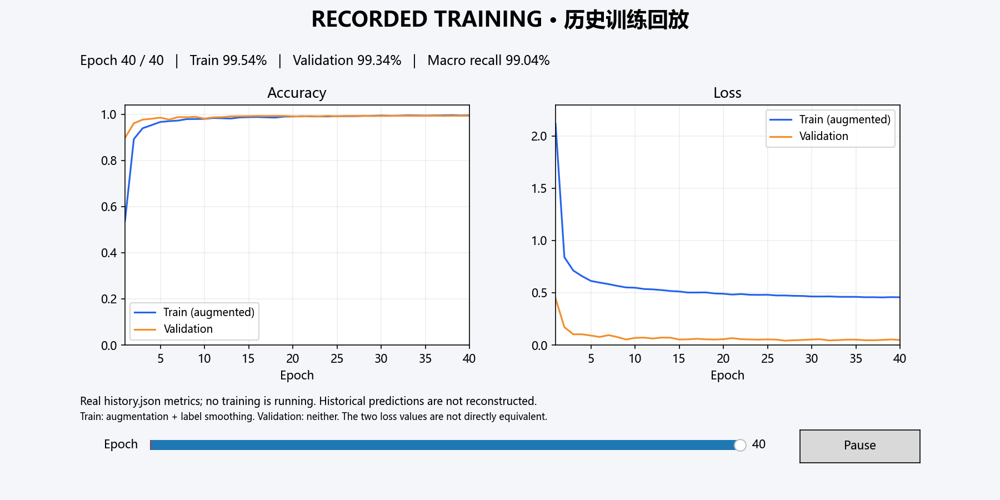

# Kana CNN：假名识别与训练可视化

一个使用 PyTorch 的 **92 类基本假名单字识别**项目，用两个 Python 文件完成训练演示和模型调用。

- **`train_demo.py`**：实时训练仪表板、历史训练回放、数据准备、评估和导出。
- **`kana_predict.py`**：可复用预测类、命令行预测、选图识别窗口；同时定义共享模型与预处理。

两个文件放在同一目录即可使用，不依赖旧工程中的 `kana_recognizer` 包。训练文件复用预测文件中的网络定义，避免训练和部署模型结构不一致。**模型权重是独立的 `models/best.pt` 文件，不内嵌在 Python 源码中。**

> 当前范围：46 个基本平假名 + 46 个基本片假名。真实手写平假名已做跨来源评估；片假名主要采用字体图训练，尚缺完整的真实手写片假名验收。本项目不等同于通用日语 OCR。



## 1. 文件结构

```text
kana_github/
├── train_demo.py           # 训练、实时图表、历史回放
├── kana_predict.py         # 模型、预处理、预测 API、选图界面
├── README.md
├── requirements.txt
├── .gitignore
├── reports/
│   ├── history.json        # 已完成的 40 轮训练日志，可直接回放
│   ├── summary.json        # 既有最佳模型的测试汇总
│   └── replay.png         # README 中的回放截图
├── models/
│   └── best.pt             # 本地已附；Git 默认忽略
├── data/prepared/          # 本地已附；Git 默认忽略
│   ├── manifest.json
│   ├── train.npz
│   ├── val.npz
│   ├── test.npz
│   └── external.npz
├── examples/kana.png       # 本地预测示例，Git 默认忽略
└── runs/                   # 新训练、截图和预测结果，Git 默认忽略
```

GitHub 源码压缩包包含两个程序、说明、依赖和训练曲线日志；不包含原始图片、训练集或权重。**只回放曲线不需要数据集或权重**。真正训练需准备 `data/prepared`；预测需提供 `best.pt`。本机交付目录已经具有这两项。

## 2. 安装

Python 3.10 或更高版本。实际验证环境为 Windows、Python 3.13、PyTorch 2.14.1+cu126、RTX 4080 Laptop GPU；CPU 推理也已验证。MPS 提供自动选择逻辑，但未经 Apple 实机验证。

```bash
python -m venv .venv
```

激活虚拟环境：

```powershell
# Windows PowerShell
.\.venv\Scripts\Activate.ps1
```

```bash
# macOS / Linux
source .venv/bin/activate
```

安装依赖：

```bash
python -m pip install -r requirements.txt
```

如需 CUDA 加速，请选用与本机环境相容的 PyTorch CUDA 安装版本。图形窗口需要桌面环境；选图窗口使用 Python 的 Tkinter，部分 Linux Python 环境需要额外安装 Tk 支持。没有图形环境时，使用 `--headless` 或命令行预测。

以下命令均在项目目录执行。默认资源路径按脚本位置解析；用户显式传入的相对路径按当前工作目录解析。

## 3. 直观看训练过程

### 方式 A：直接回放已完成的真实训练

```bash
python train_demo.py replay
```

不带参数执行 `python train_demo.py` 也会进入回放。窗口显示训练/验证准确率、损失和当前轮次；可拖动 Epoch 滑块查看任意轮次，点击 Play / Pause 播放或暂停，到末尾后循环。

```bash
# 调整回放速度：每轮 800 毫秒
python train_demo.py replay --interval 800

# 无窗口保存回放末帧
python train_demo.py replay --headless --output runs/replay.png
```

回放读取 `reports/history.json`，界面明确标注 **RECORDED TRAINING / 历史训练回放**。它不会重新训练，也不会伪造每一轮的历史预测图；现有日志只记录了指标，没有保存每轮权重。

### 方式 B：真正训练并实时演示

本地交付目录已包含准备好的数据：

```bash
python train_demo.py train --epochs 40 --output runs/my_training
```

每完成一轮，仪表板更新：

1. 训练与验证准确率曲线。
2. 训练与验证损失曲线。
3. 固定的 8 张验证样本及当前预测，绿色正确、红色错误。
4. 当前轮次、验证集 macro-recall、最佳轮次和该轮计算耗时。

验证样例在训练开始后固定，按类别均匀选取，不按预测好坏挑选。样例分数是当轮模型的未校准 softmax。训练结束后，另用验证集拟合温度并保存到最佳权重。外部测试集不参与此仪表板或最佳模型选择。

```bash
# 指定 GPU
python train_demo.py train --device cuda --epochs 40 --output runs/gpu_training

# 不弹窗，每轮仍保存最新仪表板 PNG
python train_demo.py train --headless --epochs 40 --output runs/headless_training

# 中断后恢复：输出目录与总轮数必须保持一致
python train_demo.py train --epochs 40 --output runs/my_training --resume runs/my_training/last.pt
```

新训练默认使用独立的时间戳目录，不会覆盖交付的 `models/best.pt`。指定的目录已有训练权重时，必须明确使用 `--resume`。恢复功能用于继续原定训练计划，不是把已完成的 40 轮直接变成新的 80 轮计划。

关闭图表窗口后，训练和 PNG 保存仍会继续；要中断训练请在终端按 `Ctrl+C`，可从最近保存的完整轮次恢复。训练结束后保留窗口供查看，关闭窗口即可退出程序。

输出包括：

| 文件 | 内容 |
|---|---|
| `best.pt` | 按验证集 macro-recall 选择的最佳权重、类别和预处理配置 |
| `last.pt` | 最近完整轮次、优化器、调度器与随机状态 |
| `history.json` | 各轮训练/验证指标，可用 replay 再次播放 |
| `training_dashboard.png` | 最新一轮的真实仪表板 |
| `metadata.json` | 设备、数据指纹、类别与温度 |
| `validation.json` | 最佳模型的验证指标 |

训练损失包含数据增强和标签平滑，验证损失不包含二者，**两条损失曲线的绝对值不能直接等同比较**。`seconds` 是该轮计算时间，不包含随后绘图、保存与窗口停留时间。

## 4. 使用封装好的识别器

### 选图识别窗口

```bash
python kana_predict.py --gui
```

不带参数运行也会打开窗口。选择一张单字图片后，界面显示实际送入模型的预处理图、预测结果、Top-5 候选及分数。模型只加载一次，可连续选择图片。

### 命令行

```bash
python kana_predict.py --image your_character.png
python kana_predict.py --model models/best.pt --image your_character.png --device cpu --top-k 5 --output runs/prediction.json
```

输入应是单个假名，支持黑字白底或白字黑底。预处理包括 EXIF 方向修正、透明通道处理、黑白极性判断、前景裁剪、等比例缩放、居中到 48×48；空白或对比度不足的图片会报错。

### Python API

```python
from kana_predict import KanaRecognizer

recognizer = KanaRecognizer('models/best.pt', device='auto')
result = recognizer.predict('your_character.png', top_k=5, threshold=0.8)

print(result['prediction'])
print(result['needs_review'])
for candidate in result['candidates']:
    print(candidate['character'], candidate['script'], candidate['score'])
```

导入模块不会训练、加载权重或弹出窗口。设备自动选择顺序为 CUDA → MPS → CPU。图形界面默认采用 0.8 复核阈值；CLI/API 可以自定义。`score` 是验证集温度调整后的模型分数，`needs_review` 只是阈值提示，不能保证检测未知类别、照片噪声或所有错误。

## 5. 评估和导出

```bash
python train_demo.py evaluate --model models/best.pt --data data/prepared/test.npz --output runs/test_metrics.json
python train_demo.py evaluate --model models/best.pt --data data/prepared/external.npz --output runs/external_metrics.json
python train_demo.py export --model models/best.pt --output runs/export
```

评估保存总体/逐类指标、混淆矩阵、按来源分组的成绩和逐样本预测概率。导出提供 `model.pt2`、兼容用途的 `model.torchscript` 与 `metadata.json`。导出网络输入为 float32 `[N, 1, 48, 48]`，需先执行 `kana_predict.preprocess` 并除以 255；网络输出是 logits，再除以 metadata 中的 temperature 并 softmax。导出接口会检查批量 1/2 的数值一致性。

## 6. 训练数据

本地准备数据的划分规模：

| 划分 | 数量 |
|---|---:|
| 训练 | 13,556 |
| 验证 | 2,441 |
| 本地测试 | 1,224 |
| 外部平假名基准 | 920 |

来源：

- [Hiraganani](https://github.com/drouehr/hiraganani)：46 类真实画布手写平假名，11,384 张用于训练/验证，另附 400 张测试。
- [7500-unique-kana-images](https://github.com/Orzelius/7500-unique-kana-images)：字体生成的假名图；按字体分组划分，修复 `si/ti/tu/hu` 标签映射。
- 本机已安装字体：补充缺失的基本类别，明确标为合成数据，不作为真实手写样本。
- [Inoue 手写平假名](https://github.com/inoueMashuu/hiragana-dataset)：用于外部评估，未参与训练和最佳权重选择。

准备时按预处理后像素哈希去重，划分间没有相同像素哈希；发现标签冲突的相同图像会剔除。Hiraganani 没有逐图书写者 ID，其验证划分为分层抽样，不能声称是书写者隔离。字体隔离与像素去重也不保证排除所有近似重复。

### 从原始数据准备

自行取得上述数据并保留来源信息，将文件放入本地路径。原字体库目录应含 `hiragana/*.jpeg`、`katakana/*.jpeg`，不要使用旧版缺类的 `all_kana` 目录。Windows 示例：

```powershell
python train_demo.py prepare --hiragana-train data/raw/training_images.zip --hiragana-test data/raw/test_images.zip --font-root data/raw/font_kana --external data/raw/hiragana_images.zip --supplement-fonts C:/Windows/Fonts --output data/prepared
```

`--supplement-fonts` 是本版 Windows 字体补充路径，原字体库单独使用不能覆盖全部 92 类。macOS/Linux 应提供覆盖缺失类别的额外数据，不应把这一 Windows 准备命令当成跨平台保证；**已经准备好的 NPZ 可以跨平台训练和评估**。

可用 `--extra-npz path.npz` 加入额外手写数据。格式为 `images`：N×H×W 的 uint8 灰度数组，`labels`：Unicode 单字符数组，`writers`：逐图书写者 ID 数组；不使用 pickle。额外数据按书写者分组划分。不要给未知作者随意生成不同 ID 来冒充书写者隔离。

规范化后的 `train.npz` / `val.npz` 等包含 `images`（N×48×48 uint8）、`labels`（0—91 的 int64）、`sources` 和 `ids` 字符串数组。`manifest.json` 记录类别顺序、预处理版本、来源、逐图哈希和划分。优先用 `prepare` 生成，避免自行混淆标签顺序。

## 7. 已有模型的成绩与限制

以下为交付的最佳权重成绩，不是所有重新训练都能保证达到的分数。原完整训练为 40 轮，按验证集选择第 28 轮，温度为 0.6。

| 测试范围 | 数量 | Top-1 准确率 |
|---|---:|---:|
| Hiraganani 另附测试图片 | 400 | 99.75% |
| 原字体库隔离测试 | 640 | 95.16% |
| 系统字体隔离测试 | 184 | 99.46% |
| 跨来源平假名，46 类 | 920 | **95.98%** |
| 与旧模型相同的 36 类子集 | 720 | **95.97%**（旧模型 46.25%） |

所有结果均在完整 92 类输出中竞争。外部原集的 80 张浊音/半浊音样本不在基础词表内；若将它们计错，1000 张总体为 88.30%。该外部集在早期模型分析中已经查看，不能称作完全未接触的最终盲测。

当前不支持浊音、半浊音、小假名、长音符、整句文本定位/分割或古籍草书。片假名缺少充分真实手写训练与外部测试，少数类别训练样本仍很少。单独的 `へ` 和 `ヘ` 可能存在难以消除的字形歧义。部署前应使用目标场景的新数据进行验收。

## 8. 上传 GitHub

准备好的 `kana_github_source.zip` 是源码发布包。解压后可直接创建仓库，也可以从本机项目目录初始化：

```bash
git init
git add train_demo.py kana_predict.py README.md requirements.txt .gitignore reports/history.json reports/summary.json reports/replay.png
git commit -m "Add kana recognizer and visual training demo"
git branch -M main
git remote add origin <你的GitHub仓库URL>
git push -u origin main
```

将占位符替换为真实仓库 URL。上述命令是使用说明，本项目不会自动上传或创建远程仓库。

`.gitignore` 默认忽略模型权重、数据、运行目录和本地示例。公开发布权重之前应确认训练数据允许相应分发；Hiraganani 的数据许可声明尚不明确，不能给它或其派生权重擅自套用代码许可。也不要上传第三方字体文件。项目尚未替作者选择代码 LICENSE，发布时请自行决定并添加。

## 9. 常见问题

**没有权重，能看演示吗？** 可以，运行 `python train_demo.py replay`。预测需把合法取得的兼容权重放入 `models/best.pt`，或者先准备数据并自行训练，再指定新的 `best.pt`。

**数据在哪？** 本机交付目录包含 `data/prepared`；源码压缩包和 Git 默认不包含数据。下载源码后需自行取得来源数据并准备。

**图表不显示？** 检查桌面环境和 Matplotlib 后端；服务器上使用 `--headless`。选图窗口需要 Tkinter。

**日文显示方框？** 安装支持日文字形的字体。Windows 会尝试已安装的微软雅黑/Meiryo；其他平台可在 `setup_plot` 配置可用的 CJK 字体。

**GPU 不可用或显存不足？** 先用 `--device cpu`。当前训练实现会将准备数据加载到选定设备，适用于本项目规模；扩大数据规模时应改为按批加载，不能假设无限扩容。

**空白图报错？** 这是预期行为。输入需要有清晰、完整的单个假名。
